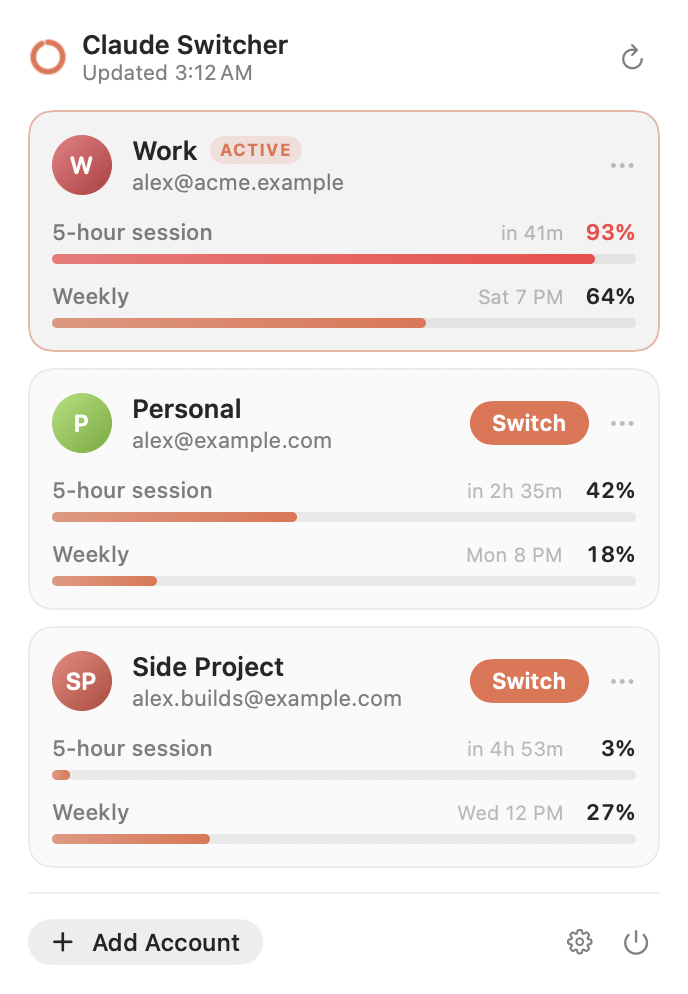
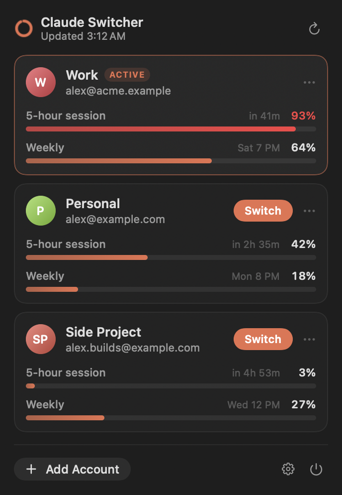

# Claude Switcher

A macOS menu bar app for people with more than one Claude account. It tracks every account's usage limits and switches Claude Desktop (Chat, Cowork and Code) between accounts in one click — or automatically when you're about to hit a limit.

<p align="center">
  
  &nbsp;&nbsp;
  
</p>

- **Live usage for every account.** 5-hour and weekly limits with reset times, even for accounts you're not signed into. The menu bar ring shows the active account at a glance.
- **One-click switching.** Claude quits, the switcher swaps the saved login, Claude reopens on the other account (~5 seconds).
- **Auto-switch.** When the active account passes a threshold (default 90% of the 5-hour limit), it asks — or just switches — to the account with the most room.
- **Your sidebar follows you.** Claude Code and Cowork sessions are shared across all accounts.
- **Chats come along.** Continue any recent chat from another account on the one you're using.

> Not affiliated with or endorsed by Anthropic. It works with Claude Desktop's local files and claude.ai's internal endpoints, which can change without notice.

## Requirements

- macOS 13 (Ventura) or later
- [Claude Desktop](https://claude.ai/download)
- Apple's Command Line Tools for the Swift compiler: `xcode-select --install` (or full Xcode)

## Install

```bash
git clone https://github.com/bsuper/claude-switcher.git
cd claude-switcher
./install.sh
```

This builds the app from source (about a minute), installs it to `~/Applications`, and launches it. Because it's built on your own Mac, there's no Gatekeeper warning.

Then, from the ring icon in the menu bar:

1. **Import Current Login** — name the account Claude Desktop is signed into right now.
2. **Add Account** — Claude reopens signed out; sign in with your next account. Repeat for each account.
3. When macOS asks to let Claude Switcher access **"Claude Safe Storage"**, choose **Always Allow**. That's how it reads each account's session to check usage. (Rebuilding the app asks again.)

To start it automatically, open the gear menu and turn on **Launch at login**.

**Update:** `git pull && ./install.sh` · **Uninstall:** `./uninstall.sh` (add `--purge` to also delete saved logins)

## Using it

| | |
|---|---|
| **Switch** | Moves Claude Desktop to that account. Anything running in Claude is interrupted, so you're asked first. |
| **Auto-switch** (gear menu) | *Off*, *Ask* (a dialog when you hit the threshold), or *Auto*. Only switches if another account is at least 10 points below the threshold; waits 20 minutes between prompts. |
| **Recent chats** | Each account lists its latest chats. **Continue here** copies the full transcript as a ready-to-paste prompt and saves a `.md` file you can attach. |
| **Bring latest chat along** | After every switch, the outgoing account's most recent chat is put on your clipboard — start a new chat and ⌘V. |
| **Share Code & Cowork sessions** | Every account sees the same Code and Cowork sidebar (details below). |

### Why chats are copied but sessions are shared

**Chat** conversations live on Anthropic's servers, per account. Another account can't open them, so the switcher hands you the transcript to continue from.

**Code and Cowork** sessions live on your Mac, but Claude Desktop files them per account (`claude-code-sessions/<account>/<org>/`, same for `local-agent-mode-sessions`) and only shows the active account's folder. On every switch, while Claude is closed, the switcher merges them:

- New and updated sessions are copied to every account; the newest version wins. Copies are APFS clones, so they use no real extra disk space.
- Deleting a session on one account removes it everywhere — it's moved to `session-trash/`, never erased.
- Conversation history needs no copying: it lives in `~/.claude/projects`, which every account already shares.
- The Code archive state and backlog are merged too. Backlog items removed on one account are removed everywhere.
- **Share scheduled tasks** (off by default) also merges Code scheduled tasks. They run on whichever account is active, so turning this on can restart tasks that stopped running when you left the account that owned them.
- Each account's own Cowork settings and caches are left alone.
- A brand-new account gets the shared sessions from **Sync Now** in the gear menu, or on the next switch. Both restart Claude.

**Where did my sessions go?** Claude Desktop's *Archive inactive sessions* setting (Settings → Claude Code) also applies to shared sessions, so older ones land under Archived rather than in the main sidebar. They aren't lost; set it to never if you want them all visible.

## How it works

A saved account is a snapshot of just Claude Desktop's login state — `Cookies`, `Local Storage`, `Session Storage`, `IndexedDB`, `WebStorage`, and the `oauth:*` / `lastKnownAccountUuid` keys in `config.json`. Settings, extensions and workspaces are untouched.

Switching asks Claude to quit (it's never force-killed; if it refuses, nothing changes), backs up the current login, saves it to the outgoing account, restores the target account, syncs sessions, and relaunches Claude.

Usage is read by decrypting each account's claude.ai session cookie with the key in the "Claude Safe Storage" keychain item, then calling `claude.ai/api/organizations/{org}/usage`. If that fails, it falls back to the usage history Claude Desktop records itself.

Everything stays on your Mac, in `~/Library/Application Support/ClaudeSwitcher/`:

| Path | Contents |
|---|---|
| `profiles/` | Saved logins, one folder per account |
| `backups/` | Login backup before each switch (last 5) |
| `backups-sessions/` | Session folders before each sync (last 3, APFS clones) |
| `session-trash/` | Sessions deleted on one account and removed from the others |
| `handoffs/` | Chat transcripts you carried over |
| `state.json` | Accounts, last known usage, settings |

The saved logins are as sensitive as being signed in — treat that folder like a password.

## Troubleshooting

- **"Keychain access … was denied"** — you clicked Deny. Click refresh in the panel and choose **Always Allow**.
- **"Session expired"** on an account — switch to it and sign in again; it's saved on the next switch.
- **"Claude didn't quit within 30s"** — Claude was showing a dialog. Close Claude yourself, then switch again.
- **Check usage from the terminal:** `~/Applications/ClaudeSwitcher.app/Contents/MacOS/ClaudeSwitcher --probe` prints the signed-in account's usage (no secrets).
- **Undo a switch gone wrong:** quit Claude and copy the newest folder in `backups/` back over the matching items in `~/Library/Application Support/Claude/`.

## Development

The whole app is one Swift file, `Sources/ClaudeSwitcher.swift`, built with `swiftc` (no Xcode project needed):

```bash
./build.sh                                   # → build/ClaudeSwitcher.app
build/ClaudeSwitcher.app/Contents/MacOS/ClaudeSwitcher --snapshot out.png --demo [--dark]   # render the panel with sample data
```

## License

[MIT](LICENSE)
